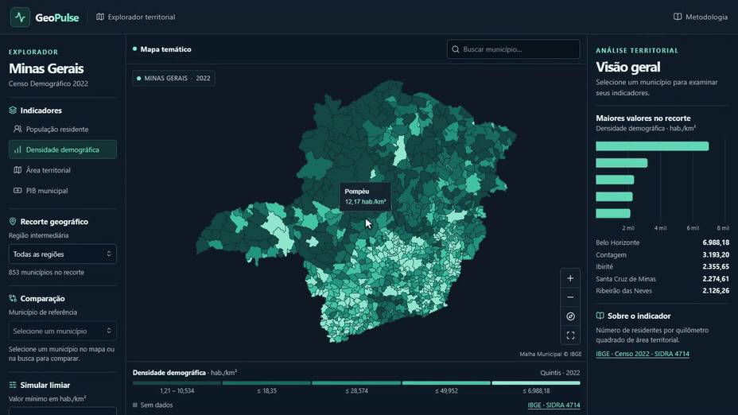

# GeoPulse

O **GeoPulse** é um visualizador geográfico criado para ajudar cientistas e pesquisadores a explorar e comunicar dados. Importe uma tabela CSV para identificar padrões espaciais, comparar regiões e apresentar resultados em um mapa interativo.

O projeto permite navegar entre países, estados, municípios e distritos conforme a cobertura das malhas. Inclui indicadores de população, densidade demográfica, área e PIB de 2022 para os 853 municípios de Minas Gerais. Desenvolvido por **oEnzoRibas**.

## Demonstração da Plataforma

O vídeo apresenta o modo **Indicadores de Minas Gerais**.



[Assistir ao vídeo completo (MP4, 36,6 s, sem áudio)](docs/media/demo.mp4?raw=true)

## Iniciar o site

Requer Node.js 22 ou superior.

```sh
cd frontend
npm ci
npm run dev
```

Abra o GeoPulse em `http://localhost:3000`. O visualizador abre no mapa mundial. O modo de indicadores de Minas Gerais usa o snapshot versionado do IBGE por padrão. A página **Metodologia** explica a origem das malhas, a importação e a classificação por quintis.

## Visualizador mundial e importação CSV

Abra `/explorar` para navegar por países, estados, municípios e distritos. Clique para inspecionar uma área e use **Shift ou Ctrl + clique** para abrir suas subdivisões. No celular ou pelo teclado, use o botão no painel da área. Em **Dados próprios**, clique em **Importar CSV** e selecione as colunas de geografia, valor e período. A prévia mostra quais áreas receberão valores antes de colorir o mapa.

Use **Ctrl + botão direito** ou **Voltar um nível** para retornar ao recorte anterior. Você pode começar na visão mundial ao importar um CSV de municípios com códigos IBGE de uma única UF. O GeoPulse abre os municípios desse estado e mantém o arquivo na prévia. Se a tabela tiver só os nomes das cidades, abra a UF primeiro. Para um arquivo municipal com várias UFs, filtre uma por vez.

O guia explica a cobertura, os formatos aceitos e como usar uma tabela do DATASUS. [Guia do visualizador mundial e da importação de CSV](docs/visualizador.md)

### CSVs de exemplo

Os valores são fictícios. Baixe um arquivo, abra o recorte indicado e clique em **Dados próprios → Importar CSV**. Selecione as colunas sugeridas, confira o número de áreas com valor e aplique a camada. Os arquivos também estão na **Biblioteca de CSVs** da página inicial e no link **Baixar CSVs de exemplo** do visualizador.

| Arquivo | Recorte | O que testar |
| --- | --- | --- |
| [Países do mundo](frontend/public/exemplos/paises-mundo.csv?raw=true) | Países e territórios, todos os continentes | 10 países por ano. Alterne entre 2022 e 2023 na prévia. |
| [Estados dos EUA](frontend/public/exemplos/estados-eua.csv?raw=true) | Estados e províncias → Estados Unidos | 5 estados por código ISO 3166-2. |
| [UFs do Brasil](frontend/public/exemplos/ufs-brasil.csv?raw=true) | Estados e províncias → Brasil | 5 UFs com delimitador ponto e vírgula e decimal com vírgula. |
| [Municípios de Minas Gerais](frontend/public/exemplos/municipios-minas-gerais.csv?raw=true) | Brasil → Minas Gerais → Municípios | 5 municípios em 2022, com código IBGE de seis dígitos e nome na mesma célula, como em tabelas do TABNET. |
| [Distritos de Belo Horizonte](frontend/public/exemplos/distritos-belo-horizonte.csv?raw=true) | Brasil → Minas Gerais → Belo Horizonte → Distritos | 3 distritos por código IBGE de nove dígitos. |

**Exemplo com dados reais.** Baixe a [tabela mundial de COVID-19 da OMS](frontend/public/data/covid-19-mundo-oms-2022.csv?raw=true) e importe em **Países e territórios**, com todos os continentes. O CSV contém casos e óbitos acumulados reportados para 223 países e territórios na data de **25/12/2022**. Selecione `iso_pais` como geografia e escolha casos ou óbitos como valor. O recorte mantém a data e os valores publicados e inclui os códigos com correspondência única na malha. As contagens refletem os registros reportados e os critérios de cada país. [OMS · Fonte original e licença CC BY 4.0](https://data.who.int/dashboards/covid19/data)

**Dengue · DATASUS.** A consulta do SINAN TabNet usa **Casos prováveis**, **Município de residência** e o período **2024**. O CSV nacional tem 5.485 municípios apresentados na consulta e 6.564.894 casos com código municipal. Os 27 registros das linhas de município ignorado ou exterior foram excluídos dos CSVs. Ao importar o recorte de Mato Grosso do Sul, o mapa abre automaticamente seus 79 municípios. A análise municipal no visualizador é feita por UF. [CSV do Brasil](frontend/public/data/dengue-brasil-2024-datasus.csv?raw=true) · [CSV de Mato Grosso do Sul](frontend/public/data/dengue-mato-grosso-do-sul-2024-datasus.csv?raw=true) · [DATASUS · TabNet Dengue](https://datasus.saude.gov.br/acesso-a-informacao/doencas-e-agravos-de-notificacao-de-2007-em-diante-sinan/)

### Onde baixar dados reais

A seção **Onde baixar dados reais** da página inicial indica como preparar as tabelas antes de importar. Para dados por país, use o Banco Mundial. Para dados municipais brasileiros, use o DATASUS TabNet ou o IBGE SIDRA. [Banco Mundial · População por país](https://data.worldbank.org/indicator/SP.POP.TOTL) · [DATASUS · Mortalidade geral](https://datasus.saude.gov.br/mortalidade-desde-1996-pela-cid-10/) · [IBGE SIDRA · Tabela 4714](https://sidra.ibge.gov.br/tabela/4714)

## Usar a API e o PostGIS

A partir da raiz, com Docker Compose ativo:

```sh
docker compose up -d --build api
```

O Compose sobe o PostGIS, aplica as migrações SQL versionadas e carrega o snapshot em uma transação antes de iniciar a API. As importações são serializadas por um bloqueio transacional. A documentação OpenAPI fica em [localhost:8000/docs](http://localhost:8000/docs). Para usar a API no navegador, copie `frontend/.env.example` para `frontend/.env.local`, defina `NEXT_PUBLIC_API_URL=http://127.0.0.1:8000` e reinicie o Next.js.

| Rota | Retorno |
| --- | --- |
| `/health` | Estado da API e modo de armazenamento |
| `/v1/metadata` | Ano, cobertura e fontes |
| `/v1/municipalities` | Indicadores por município, com filtro opcional `?region=3101` |
| `/v1/municipalities/{code}` | Indicadores para um código IBGE |
| `/v1/municipalities.geojson` | Malha e indicadores |
| `/v1/locate?lon=-43.95&lat=-19.92` | Municípios cujo polígono cobre a coordenada, em modo PostGIS |

A API também pode servir o snapshot diretamente. Com Python 3.12+, instale `backend/requirements.txt` e execute `python -m uvicorn backend.main:app` na raiz com `DATABASE_URL` ausente.

## Regenerar a base oficial

```sh
python -m pip install -r scripts/requirements.txt
python scripts/build_snapshot.py
```

O ETL verifica os 853 identificadores e cruza as fontes abaixo. A simplificação usa projeção métrica EPSG:5880 e tolerância de 220 m, com preservação das fronteiras compartilhadas. O GeoJSON de exibição é exportado em EPSG:4326. Os valores oficiais de área e densidade são preservados. O argumento opcional `--cache` permite reaproveitar os arquivos brutos.

- [IBGE · SIDRA 4714, Censo Demográfico 2022](https://sidra.ibge.gov.br/tabela/4714)
- [IBGE · SIDRA 5938, PIB dos Municípios](https://sidra.ibge.gov.br/tabela/5938)
- [IBGE · Malha Municipal 2022 de Minas Gerais](https://geoftp.ibge.gov.br/organizacao_do_territorio/malhas_territoriais/malhas_municipais/municipio_2022/UFs/MG/)
- [IBGE · API de Localidades, municípios de Minas Gerais](https://servicodados.ibge.gov.br/api/v1/localidades/estados/31/municipios)

## Deploy

- **Vercel**. Aponte o diretório raiz do projeto para `frontend` e selecione o preset Next.js. O build produz a exportação estática em `out/`. Configure `NEXT_PUBLIC_API_URL` antes do build para usar uma API remota.
- **API**. Use a raiz deste repositório como contexto e `backend/Dockerfile` como Dockerfile. Para PostGIS gerenciado, configure `DATABASE_URL` com a URL do banco e execute `python -m backend.import_snapshot` como etapa de inicialização da base. O ambiente de migração precisa ter permissão para criar a extensão PostGIS ou encontrá-la pré-instalada. Configure `CORS_ORIGINS` com as origens do frontend separadas por vírgula.
- **CI**. O GitHub Actions compila o frontend e verifica a importação da malha e uma consulta espacial em PostGIS.

## Participar do projeto

As releases reúnem as versões e suas notas. Para propor mudanças, consultar as regras de convivência ou comunicar uma vulnerabilidade, use os canais do projeto. [Releases](https://github.com/oEnzoRibas/GeoPulse/releases) · [Guia de contribuição](CONTRIBUTING.md) · [Código de conduta](CODE_OF_CONDUCT.md) · [Política de segurança](SECURITY.md)

## Licença e atribuição

O código original do GeoPulse é distribuído sob a licença MIT. Os indicadores e limites municipais têm origem no IBGE. Ao reutilizar os dados ou mapas derivados, preserve a atribuição, o ano de referência e a identificação das fontes. As dependências de terceiros seguem suas próprias licenças. [Licença do código](LICENSE) · [Fontes dos dados](#regenerar-a-base-oficial)
